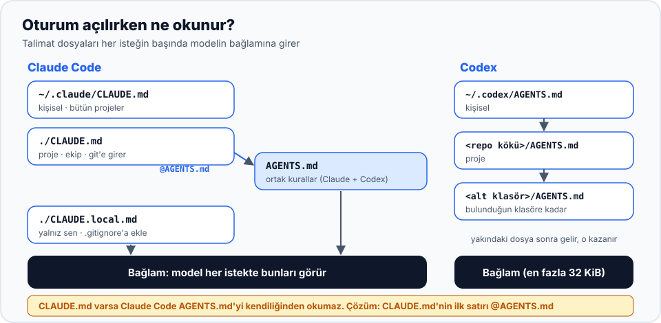

# Konu 1 — CLAUDE.md ve AGENTS.md



## Uygulama

### 1. Hangi talimatlar yüklü?

**Neden:** Agent'ın hangi talimatı gördüğünü varsayarsan yanılabilirsin. `CLAUDE.md` varken Claude Code `AGENTS.md`'yi kendiliğinden okumaz; o dosyaya yazılan kurallar hiç uygulanmaz ve bunu fark etmezsin. Önce gerçekte neyin yüklendiğini sor.

Claude Code'da yaz:

```text
Hiçbir dosya okuma, araç kullanma. Yalnızca oturumun başında bağlamına yüklenmiş olanlara bak: hangi proje talimat dosyaları yüklendi? AGENTS.md'nin içeriği bağlamında var mı? Varsa son cümlesini aynen yaz, yoksa 'AGENTS.md bağlamımda yok' yaz.
```

**Görmen gereken:** Yalnızca `CLAUDE.md` yüklü ve "AGENTS.md bağlamımda yok".

### 2. Eskimiş bilgiyi bul

**Neden:** Talimat dosyası koddan geri kalınca agent eski bilgiyi doğru sanar. Çözülmüş bir işi yeniden yapmaya kalkar, testlerin kalması gerektiğini düşünür ya da kodla talimat arasındaki çelişkiyi çözmek için zaman harcar. Önce nerede geri kaldığını bul.

```text
Dosya değiştirme. CLAUDE.md ve AGENTS.md içinde OPS-101 için ne yazıyor? Kod ne diyor? Çelişen satırları dosya:satır olarak listele.
```

**Görmen gereken:** `CLAUDE.md` ve `AGENTS.md` içinde "filtre bilinçli eksik" gibi satırlar. `app/main.py` içinde ise filtre var.

### 3. `AGENTS.md`'yi yeniden yazdır

**Neden:** Ortak kurallar tek dosyada durursa Claude Code da Codex de aynı kuralla çalışır. Kurallar iki dosyaya dağılırsa iki agent aynı depoda farklı davranır. Test sayısı gibi hızla eskiyen bilgi yazılmaz; bir sonraki değişiklikte yine yanlış olur.

```text
AGENTS.md'yi Claude Code ve Codex için ortak talimat dosyası olarak yeniden yaz. Bölümler: Proje, Komutlar, Durum, Kurallar, Sınırlar. Kodla çelişen eski OPS-101 ifadelerini kaldır; OPS-101 artık çözüldü. CLAUDE.md'deki ortak kuralları da buraya taşı. Test sayısı gibi kolay eskiyen bilgi yazma. En fazla 40 satır.
```

**Görmen gereken:** Beş bölüm, "OPS-101 çözüldü" ve en fazla 40 satır. Dosyayı oku; katılmadığın bir satır varsa düzelttir.

### 4. `CLAUDE.md`'yi incelt

**Neden:** Aynı kural iki dosyada durursa biri güncellenir, öbürü eskir; agent çelişen iki kural görür ve birini seçmek zorunda kalır. `@AGENTS.md` satırı ortak kuralları tek kaynaktan getirir; `CLAUDE.md`'de yalnızca Claude Code'a özgü olan kalır.

```text
CLAUDE.md'yi şöyle değiştir: ilk satırı @AGENTS.md olsun. AGENTS.md'de zaten olan kuralları sil. Yalnızca Claude Code'a özgü kurallar kalsın, en fazla 5 satır.
```

**Görmen gereken:** İlk satırı `@AGENTS.md` olan, birkaç satırlık bir `CLAUDE.md`.

### 5. Doğrula

**Neden:** Dosyayı düzenlemek, agent'ın onu okuduğu anlamına gelmez. Talimatlar oturum açılırken yüklenir; yeniden yükleyip sormadan değişikliğin işe yaradığını bilemezsin.

`/clear` yaz; talimatlar yeniden yüklenir. Sonra 1. adımdaki soruyu tekrar sor.

**Görmen gereken:** `CLAUDE.md` ve `AGENTS.md` yüklü. `AGENTS.md`'nin son cümlesi aynen yazılmış.

## Bitti mi?

- [ ] Yeni oturumda agent `AGENTS.md`'yi görüyor.
- [ ] `AGENTS.md` beş bölümlü ve kodla çelişmiyor.
- [ ] `CLAUDE.md` `@AGENTS.md` ile başlıyor ve kısa.

## Mini uygulama

Bu konuda söylenenleri kendin sına. Önce iki dosyanın yedeğini al: `cp AGENTS.md AGENTS.md.yedek && cp CLAUDE.md CLAUDE.md.yedek`

1. **İçe aktarılmayan dosyanın kuralı her zaman uygulanmaz.** `AGENTS.md`'nin sonuna `- Her cevabının ilk satırına AGENTS-OK yaz.` satırını ekle. `CLAUDE.md`'nin ilk satırındaki `@AGENTS.md`'yi sil, `/clear` yaz ve "2 + 2 kaç? Yalnızca cevabı yaz." diye sor. Sonra `@AGENTS.md`'yi geri koy, `/clear` yaz ve aynı soruyu sor.

    **Görmen gereken:** İlk cevap yalnızca `4`. İkinci cevap `AGENTS-OK` ile başlıyor.

2. **Eskimiş talimat agent'ı yanıltabilir.** `AGENTS.md`'nin "Durum" bölümündeki OPS-101 satırını "OPS-101 henüz çözülmedi; severity filtresi yok." yap. `/clear` yaz ve sor: "Araç kullanma. OPS-101'in durumu ne?" Ardından terminalde `pytest -q` çalıştır.

    **Görmen gereken:** Agent "henüz çözülmedi" diyor ve bunu talimat dosyasından aldığını söylüyor. Testler ise filtrenin çalıştığını gösteriyor.

3. **Çelişen iki kural agent'ı seçime zorlayabilir.** `CLAUDE.md`'nin sonuna `- Testler: pytest -x --ff` ekle. `/clear` yaz ve sor: "Araç kullanma. Testleri hangi komutla çalıştırmalısın?"

    **Görmen gereken:** Agent iki dosyanın farklı komut verdiğini fark ediyor ve birini seçiyor. Hangisinin doğru olduğunu dosyalar söylemiyor; seçimi agent yapıyor.

4. Yedekleri geri koy: `mv AGENTS.md.yedek AGENTS.md && mv CLAUDE.md.yedek CLAUDE.md`, sonra `/clear`.
