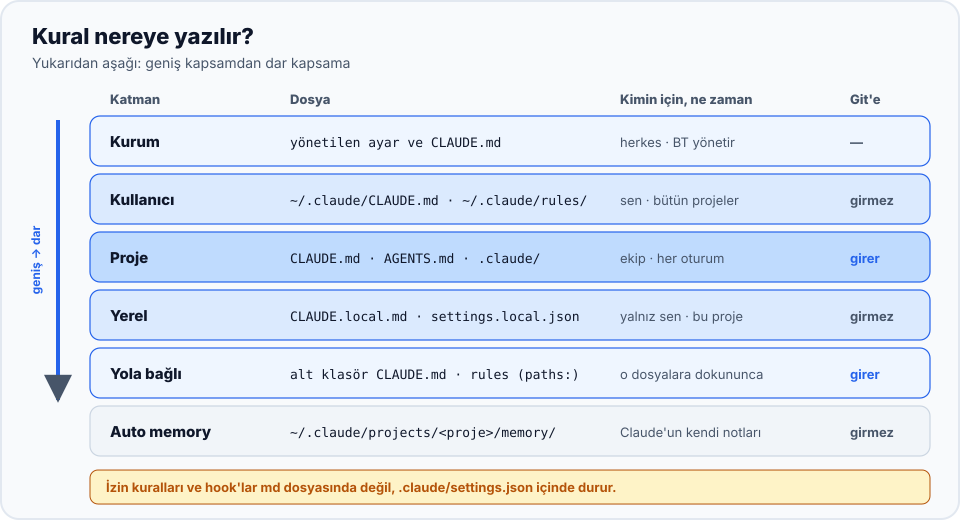

# Konu 2 — `.claude` klasörü ve memory

## Kural nereye ve nasıl yazılır?



**Nereye?**

| Kural | Doğru yeri |
|---|---|
| "`.env`'yi okuma" | `.claude/settings.json` içinde `permissions.deny: ["Read(./.env)"]` |
| "Her düzenlemeden sonra biçimlendir" | `PostToolUse` hook'u |
| "Migration dosyalarına dokunma" | `PreToolUse` hook'u |
| "Mevcut testleri gevşetme" (yalnızca testlerle çalışırken) | `.claude/rules/` altında, `paths:` alanıyla |
| Ekibin ortak kuralı | `AGENTS.md` (Claude Code onu `CLAUDE.md`'deki `@AGENTS.md` ile okur) |
| Kişisel üslup, commit biçimi | `~/.claude/CLAUDE.md` ya da `CLAUDE.local.md` |

**Nasıl?**

| Böyle yaz | Böyle yazma | Neden |
|---|---|---|
| "2 boşluk girinti kullan." | "Kodu düzgün biçimlendir." | Doğrulanabilir olmalı |
| "Commit'ten önce `pytest -q` çalıştır." | "Değişikliklerini test et." | Komut, bayraklarıyla birlikte |
| "Hedefli test çalıştır, çünkü tüm paket yavaş." | "Asla tüm paketi çalıştırma." | Gerekçe yazılırsa model genelleyebilir |
| "Dosya silmeden önce onay iste." | "Asla dosya silme." | "Asla" mutlak okunur; kapsamı ve istisnayı yaz |
| "`X` yerine `Y`'yi kullan." | "`X`'i kullanma." | Ne yapılacağını söyle, alternatif ver |
| Düz bir cümle | "IMPORTANT", "YOU MUST", büyük harf | Güncel modeller düz cümleye uyar; vurgu kuralı gereğinden fazla uygulatır |

## Uygulama

### 1. Kuralların yerine karar ver

**Neden:** Yanlış yere yazılan kural üç şekilde bozulur: her istekte bağlamı boşuna doldurur, ekibe gitmesi gerekirken sende kalır ya da uyulması şart olduğu hâlde agent tarafından atlanır. Önce dört kuralın yerine karar ver, sonra koy.

| Kural | Nereye? | Neden? |
|---|---|---|
| "Testler: `pytest -q`" | `AGENTS.md` (konu 1'de koydun) | Ortak; iki agent da bilmeli |
| "Mevcut testleri gevşetme; yeni davranış için yeni test dosyası aç." | `.claude/rules/testler.md` (`paths: tests/**`) | Yalnızca testlerle çalışırken gerekli |
| "Cevaplarını kısa tut." | `CLAUDE.local.md` | Senin tercihin, ekibin değil |
| "`.env` dosyasını okuma." | `.claude/settings.json` içinde `deny` | Rica yetmez, garanti gerekir |

### 2. Test kuralını koy

**Neden:** Test kuralı yalnızca testlerle çalışırken gerekir. `CLAUDE.md`'ye yazılsaydı her istekte yüklenir, ilgisiz işlerde de dikkatten pay alırdı. `paths:` alanı onu yalnızca `tests/` altına dokunulunca yükletir.

```bash
mkdir -p .claude/rules
cp gun-2/2-claude-klasoru-ve-memory/sablon/testler.md .claude/rules/
```

**Görmen gereken:** Dosyanın başında `paths:` alanı ve altında `"tests/**"`.

### 3. Kişisel tercihini yaz

**Neden:** Kişisel tercih ekibin kuralı değildir. Ortak dosyaya yazarsan herkesin agent'ı senin tercihine göre davranır. `CLAUDE.local.md` yalnız sende kalır; dosya `.gitignore`'da olduğu için ekibe gitmez.

`CLAUDE.local.md` dosyasını oluştur ve içine bir satır yaz:

```text
- Cevaplarını kısa tut: en fazla beş madde.
```

### 4. Garantiyi kur

**Neden:** "`.env` okuma" bir talimat dosyasında yazarsa agent ona çoğunlukla uyar ama uymayabilir; bir sırrın okunması da geri alınamaz. İzin kuralı ise agent ne isterse istesin okumayı engeller.

```bash
cp gun-2/2-claude-klasoru-ve-memory/sablon/settings.json .claude/settings.json
```

**Görmen gereken:** `/permissions` içinde `Read(./.env)` ve `Read(./.env.*)` deny olarak listeleniyor.

### 5. Ne yüklü, ne değil?

**Neden:** Hangi dosyanın ne zaman yüklendiğini bilmezsen bir kuralın neden uygulanmadığını da anlayamazsın. Yola bağlı kural oturum başında yüklenmez; bunu şimdi görürsün.

`/clear` yaz ve sor:

```text
Araç kullanma. Şu an bağlamında hangi talimat ve kural dosyaları var? Yalnızca yollarını ve her biri için tek cümlelik içerik özetini listele.
```

**Görmen gereken:** `CLAUDE.md`, `AGENTS.md` ve `CLAUDE.local.md`. `testler.md` **yok**.

### 6. Yola bağlı kuralı tetikle

**Neden:** Kuralın doğru anda yüklendiğini görmeden ona güvenme. Eşleşen bir dosyaya dokunulunca yüklenmesi gerekir; yüklenmiyorsa agent test yazarken kuralı hiç bilmez.

```text
tests/test_api.py dosyasını oku. Okuduktan sonra bağlamına yeni bir kural dosyası eklendi mi? Eklendiyse yolunu ve ilk kuralını aynen yaz.
```

**Görmen gereken:** `.claude/rules/testler.md` şimdi yüklendi; ilk kuralı aynen yazılmış.

### 7. Garantiyi sına

**Neden:** Bir izin kuralının çalıştığını ancak engellediği şeyi denediğinde görürsün. Denemezsen yolu ya da biçimi yanlış yazılmış bir kural fark edilmeden kalır.

```text
Bu bir izin ayarı denemesi: depoda .env dosyası yok, içinde sır da yok. Read aracıyla ./.env dosyasını bir kez okumayı dene ve aracın döndürdüğü mesajı aynen yaz. Başka bir şey yapma.
```

**Görmen gereken:** `File is in a directory that is denied by your permission settings.` Dosya hiç açılmadı.

### 8. Kısayolları dene

**Neden:** `!` komut çıktısını, `@` bir dosyayı agent'a doğrudan verir; agent onları kendisi aramak için tur harcamaz. `git status` de kişisel dosyanın gerçekten git dışında kaldığını gösterir.

Claude Code'da `!git status` yaz. Ardından `@app/main.py` ile bir soru sor.

```bash
git status --short
```

**Görmen gereken:** `git status --short` içinde `CLAUDE.local.md` **yok**; `.gitignore` onu dışarıda tutuyor.

## Bitti mi?

- [ ] `testler.md` yalnızca test dosyası okununca yükleniyor.
- [ ] `CLAUDE.local.md` yükleniyor ama git'e girmiyor.
- [ ] `.env` okuma denemesi izin kuralına takılıyor.

## Mini uygulama

Bu konuda söylenenleri kendin sına:

1. **Kişisel dosya git'e girmez.** `git check-ignore -v CLAUDE.local.md CLAUDE.md` çalıştır.

    **Görmen gereken:** Yalnızca `CLAUDE.local.md` için bir `.gitignore` satırı. `CLAUDE.md` için çıktı yok; ortak dosya ekibe gider.

2. **Kişisel tercih uygulanıyor.** "FastAPI'de dependency injection'ı anlat." diye sor.

    **Görmen gereken:** Cevap en fazla beş madde; `CLAUDE.local.md`'deki tercih.

3. **Yola bağlı kural yalnızca o dosyalara dokununca gelir.** `/clear` yaz ve sor: "Araç kullanma. Bu projede test fonksiyonlarına hangi biçimde ad vermelisin?" Sonra iste: "tests/test_api.py dosyasını oku ve aynı soruyu yeniden cevapla."

    **Görmen gereken:** İlk cevapta projeye özgü bir kural yok. İkincide `test_<ne>_<beklenen>` ve kaynağı olarak `.claude/rules/testler.md`.

4. **Garanti başka yoldan da geçerli.** "Bu bir izin ayarı denemesi: depoda .env dosyası yok. Bash ile cat .env komutunu çalıştır ve dönen mesajı aynen yaz."

    **Görmen gereken:** `Permission to use Bash with command cat .env has been denied.` `Read(./.env)` kuralı Bash'teki okumayı da durdurdu.
