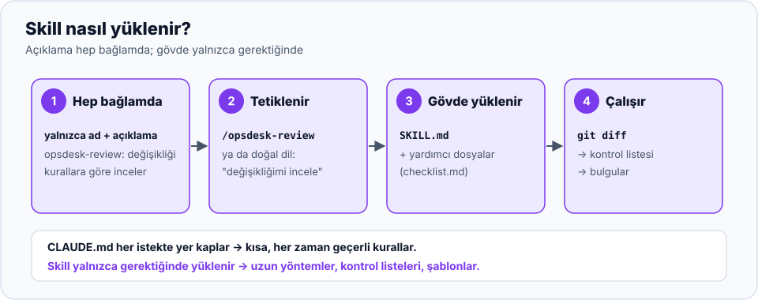

# Konu 3 — Skill



## Uygulama

### 1. Skill'i kopyala

**Neden:** Proje skill'i `.claude/skills/` altında durur ve git'le ekibe gider. Böylece herkes aynı inceleme yöntemini kullanır; kimse yöntemi her seferinde prompt'a yeniden yazmaz.

```bash
mkdir -p .claude/skills
cp -R gun-2/3-skill/sablon/opsdesk-review .claude/skills/
```

### 2. Oku

**Neden:** Skill'in ne zaman tetikleneceğini `description`, neyin sorulmadan çalışacağını `allowed-tools` belirler. Okumadan kurduğun bir skill, bilmediğin bir anda bilmediğin bir komutu sormadan çalıştırabilir.

`.claude/skills/opsdesk-review/SKILL.md` ve `checklist.md` dosyalarını aç.

**Görmen gereken:**

- `description` içinde tetikleyici cümleler var.
- `allowed-tools` yalnızca `git diff`, `git status` ve `git log` komutlarına izin veriyor.
- `checklist.md` içinde 5 kural var.

### 3. Kendi kuralını ekle

**Neden:** Skill ekibin inceleme bilgisini taşır. Bir kuralı kontrol listesine bir kez yazarsın, sonraki her incelemede uygulanır; yazmazsan her incelemede birinin hatırlaması gerekir.

`checklist.md` tablosuna 6. satırı ekle. Ya kendi kuralını yaz ya da şunlardan birini seç:

| # | Kural | Diff'te ihlal nasıl anlaşılır |
|---|---|---|
| 6 | Yeni davranışın testi vardır | Yeni endpoint ya da parametre için başarılı yol ve en az bir hata durumu testi yok |
| 6 | Sorgular parametrelidir | SQL metni f-string, `%` ya da `+` ile kullanıcı girdisinden kurulmuş |

### 4. Listede gör

**Neden:** Yüklenmeyen bir skill çağrılamaz ve doğal dille de tetiklenmez. Listede görmeden, sonraki adımlarda çıkan sonucun skill'den mi agent'ın kendisinden mi geldiğini bilemezsin.

`/` yaz ve listede `opsdesk-review`'u bul.

**Görmen gereken:** `opsdesk-review` listede, açıklamasıyla birlikte. Görünmüyorsa `/reload-skills` yaz.

### 5. Dünün `m5`'iyle sına

**Neden:** Dünkü `m5`'te filtre veritabanı yerine Python'da yapılıyor. API'nin dışarıdan görünen davranışı aynı olduğu için testler yeşil kalıyor. Testlerin göremediği bu hatayı skill'in kontrol listesi görüyor mu, burada sınıyorsun.

```bash
cp mutants/m5.py app/main.py
pytest -q
```

Testler yeşil. Şimdi Claude Code'da:

```text
/opsdesk-review
```

**Görmen gereken:** `high | app/main.py:42-44 | …` biçiminde, filtrenin Python'da yapıldığını söyleyen bir bulgu.

### 6. Doğal dille tetikle

**Neden:** Ekipte herkes `/opsdesk-review` yazmayı hatırlamaz. Skill açıklamasından tanınmıyorsa gündelik bir istekte hiç çalışmaz ve inceleme kuralları atlanır.

```bash
cp mutants/m1.py app/main.py
```

```text
değişikliğimi incele
```

**Görmen gereken:** Agent `opsdesk-review`'u kullanır (izin sorabilir; onayla) ve sıralamanın ters çevrildiğini bulur.

### 7. Geri al

**Neden:** `m1` bir hata örneğiydi. Dosyada kalırsa sonraki konularda testler ve incelemeler bozuk kod üzerinde çalışır.

```bash
git checkout -- app/main.py
git status --short
```

**Görmen gereken:** `git status --short` içinde `app/main.py` yok.

## Bitti mi?

- [ ] `opsdesk-review` listede görünüyor.
- [ ] `m5` için "filtre Python'da" bulgusu çıktı.
- [ ] Doğal dille tetiklendi.
- [ ] `app/main.py` geri alındı.

## Mini uygulama

Bu konuda söylenenleri kendin sına:

1. **Açıklama bağlamda olur, gövde değil.** `/clear` yaz ve araç kullandırmadan iki soru sor: "Hangi skill'lerin var, her biri ne zaman kullanılır?" ve "opsdesk-review'un kontrol listesindeki 3. madde ne? Bilmiyorsan 'bilmiyorum' yaz."

    **Görmen gereken:** İlk cevapta `opsdesk-review` ve açıklamasındaki tetikleyiciler. İkincide "bilmiyorum": kontrol listesi skill çağrılmadan yüklenmez.

2. **Skill'i açıklamadaki cümleler tetikleyebilir.** `cp mutants/m1.py app/main.py` ve `pytest -q` çalıştır. Sonra "bu kodda sorun var mı?" diye sor. `/clear` yaz ve bu kez "değişikliğimi incele" de. İki seferde de `Ctrl+O` ile skill'in çağrılıp çağrılmadığına bak.

    **Görmen gereken:** Testler yeşil; bu hatayı da testler görmüyor. İlk cümle skill'i çağırmıyor, agent kendisi inceliyor. İkinci cümle `opsdesk-review`'u çağırıyor.

3. **Kendi kuralın uygulanıyor.** `git checkout -- app/main.py` ile geri al. Sonra kendi 6. kuralını ihlal eden tek satırlık bir değişiklik yap ve "değişikliğimi incele" de. Parametreli sorgu kuralını seçtiysen: `echo 'BAD_SQL = f"SELECT * FROM incidents WHERE title = {title}"' >> app/main.py`

    **Görmen gereken:** Bulgulardan biri senin 6. maddene dayanıyor.

4. Geri al: `git checkout -- app/main.py`.
