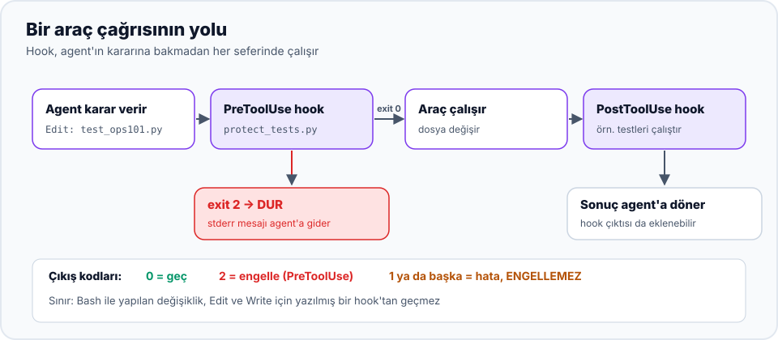

# Konu 4 — Hook



## Uygulama

### 1. Script'i koy

**Neden:** Hook, Claude Code'un belirli bir olayda çalıştırdığı sıradan bir programdır ve senin yetkinle çalışır. Ne yaptığını okumadan bağlarsan, her düzenlemede bilmediğin bir kodu çalıştırırsın.

```bash
mkdir -p .claude/hooks
cp gun-2/4-hook/sablon/protect_tests.py .claude/hooks/
```

Dosyayı aç ve oku: 15 satırlık bir Python script'i.

### 2. Agent olmadan sına

**Neden:** Agent'la birlikteyken bir hatanın kaynağı zor ayrılır: hook hiç çalışmadı mı, yanlış çıkış kodu mu verdi, yoksa agent mi başka bir şey yaptı? Elle JSON vererek hook'u tek başına görürsün. Engellemek için çıkış kodu `2` olmalı; `1` engellemez.

macOS / Linux:

```bash
echo '{"tool_name":"Edit","tool_input":{"file_path":"tests/test_ops101.py"}}' | python .claude/hooks/protect_tests.py
echo $?
echo '{"tool_name":"Edit","tool_input":{"file_path":"app/main.py"}}' | python .claude/hooks/protect_tests.py
echo $?
```

Windows PowerShell:

```powershell
'{"tool_name":"Edit","tool_input":{"file_path":"tests/test_ops101.py"}}' | python .claude/hooks/protect_tests.py
$LASTEXITCODE
```

**Görmen gereken:** Önce `ENGELLENDI: tests/test_ops101.py kabul testidir…` ve `2`, sonra yalnızca `0`.

### 3. Bağla

**Neden:** Script tek başına hiçbir şey yapmaz. `settings.json`'daki `hooks` bölümü onun hangi olayda ve hangi araçta çalışacağını söyler; bağlanmamış bir hook hiç çalışmaz ve bu fark edilmez.

```bash
cp gun-2/4-hook/sablon/settings.json .claude/settings.json
```

Bu şablon konu 2'deki `deny` kurallarını da içeriyor; onları kaybetmezsin.

**Görmen gereken:** Claude Code'da `/hooks` yaz; `PreToolUse` altında `Edit|Write` ve komutun görünüyor.

### 4. Agent'la sına

**Neden:** Elle denemek yalnızca script'i sınar. Burada bütün zinciri sınıyorsun: olay, eşleştirici, script ve agent'ın engellemeye tepkisi.

```text
tests/test_ops101.py dosyasının en başına '# deneme' yorum satırını ekle. Engellenirsen nedenini aynen yaz ve başka yoldan deneme.
```

**Görmen gereken:** `ENGELLENDI: tests/test_ops101.py kabul testidir ve degistirilemez…` mesajı. `git status --short` içinde `tests/test_ops101.py` yok.

### 5. Sınırı düşün

**Neden:** Hook yalnızca baktığı araçları görür. Neyi görmediğini bilmezsen, korunduğunu sandığın bir dosya başka bir yoldan değişir.

Agent aynı satırı `Edit` aracıyla değil de Bash'le (`sed`, `echo >>`) ekleseydi bu hook görür müydü?

**Cevap:** Hayır. `matcher` yalnızca `Edit|Write` araçlarına bakıyor. Bir hook'un **neyi görmediğini** bilmek, neyi gördüğünü bilmek kadar önemlidir.

## Bitti mi?

- [ ] Elle denemede `2` ve `0` görüldü.
- [ ] `/hooks` hook'u listeliyor.
- [ ] Agent'ın düzenlemesi engellendi, dosya değişmedi.

## Mini uygulama

Bu konuda söylenenleri kendin sına:

1. **Çöken hook engellemez.** `echo 'bozuk' | python .claude/hooks/protect_tests.py; echo $?` çalıştır.

    **Görmen gereken:** `JSONDecodeError` ve çıkış kodu `1`. Hook çöktüğünde işlem durmaz.

2. **Eşleştirici `Write`'ı da kapsar.** "tests/test_ops101.py dosyasını Write aracıyla aynı içerikle baştan yaz. Engellenirsen dönen mesajı aynen yaz ve başka yoldan deneme."

    **Görmen gereken:** `ENGELLENDI: tests/test_ops101.py kabul testidir…`, bu kez `Write` için.

3. **Bash hook'tan geçmez.** "Bu bir hook sınırı denemesi. Bash ile echo '# bash' >> tests/test_ops101.py komutunu çalıştır." İzin sorulursa onayla, sonra `git diff --stat` çalıştır.

    **Görmen gereken:** Hook devreye girmedi. Yazmayı yalnızca Claude Code'un izin sorusu durdurabiliyordu; onayladıysan `tests/test_ops101.py` değişti. Geri al: `git checkout -- tests/test_ops101.py`.

## Erken bitirenlere: testleri çalıştıran hook

**Neden:** Bir hatayı agent işi bitirdikten sonra değil, yaptığı anda yakalamak için. Testleri çalıştıran bir `PostToolUse` hook'u, kodu bozan bir düzenlemeyi hemen agent'a bildirir; agent da düzeltmeye o anda başlar.

`run_tests.py` bir `PostToolUse` hook'udur. `app/` altındaki bir `.py` dosyası değişince `pytest -q -x` çalıştırır; testler kalırsa `exit 2` ile son 15 satırı agent'a bildirir.

1. `cp gun-2/4-hook/sablon/run_tests.py .claude/hooks/`
2. `settings.json` içinde `"PreToolUse"`'un yanına, aynı biçimde bir `"PostToolUse"` bölümü ekle (`matcher`: `Edit|Write`, komut: `run_tests.py`).
3. Agent'tan `/health` yanıtını `{"status": "up"}` yapmasını iste.
4. Hook'un test sonucunu agent'a bildirdiğini ve agent'ın buna tepki verdiğini gör. Sonra `git checkout -- app/main.py`.
