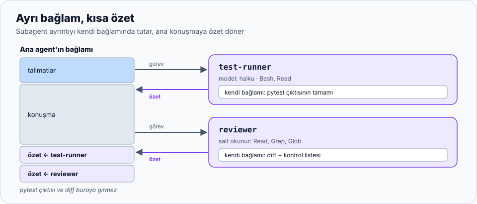
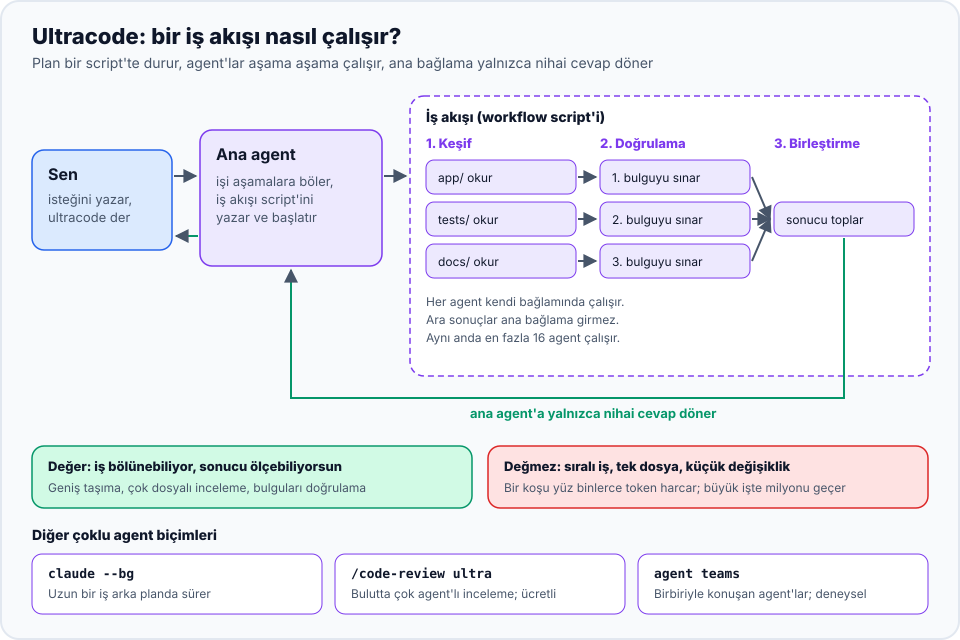

# Konu 5 — Subagent ve çoklu agent

## Bir bakışta

- **Subagent**, ana agent'ın bir işi devrettiği yardımcı agent'tır. Kendi bağlamında çalışır ve ana konuşmaya yalnızca **özet** döner.
- Her subagent'ın kendi araç izinleri ve modeli olabilir. Örneğin `reviewer` yalnızca okuyabilir, `test-runner` ucuz ve hızlı bir modelle çalışır.
- Bedeli var: daha fazla token harcar ve ayrıntının bir kısmı özette kaybolur. Her iş için değil, ayrı bağlam gerçekten işe yarayınca kullan.

## Nasıl çalışır?



1. Ana agent bir görevi subagent'a bir **brief** ile verir.
2. Subagent kendi bağlamında çalışır: dosya okur, komut çalıştırır. Bunların hepsi onun bağlamında kalır.
3. Ana agent'a yalnızca sonuç ya da özet döner.

Hazır subagent'lar:

| Ad | İşi |
|---|---|
| `Explore` | Salt okunur arama: "bu kod nerede, nasıl bağlanıyor?" |
| `Plan` | Salt okunur plan çıkarma |
| `general-purpose` | Bütün araçlarla çok adımlı iş |

Kendi subagent'ın `.claude/agents/<ad>.md` dosyasında durur:

```markdown
---
name: reviewer
description: Değişiklikleri OpsDesk kontrol listesine göre inceleyen salt-okunur gözden geçirici. ...
tools: Read, Grep, Glob
---
Sen OpsDesk için salt-okunur bir kod gözden geçiricisin. ...
```

| Alan | İşi |
|---|---|
| `description` | Ana agent işi ne zaman devredeceğine buna bakarak karar verir |
| `tools` | İzin verilen araçlar; yazılmazsa hepsi |
| `model` | Örneğin `haiku`: kısa ve mekanik işler için ucuz ve hızlı |

**Çağırma:** Ana agent açıklamaya bakıp kendisi seçer. Doğal dille de söyleyebilirsin ("reviewer ile incelet") ya da `@agent-reviewer` yazabilirsin.

## Nerede durur?

```text
.claude/agents/reviewer.md      ← proje subagent'ı (ekip)
.claude/agents/test-runner.md
~/.claude/agents/<ad>.md        ← kişisel, bütün projelerde
```

## Ne zaman subagent?

- **Subagent daha akıllı bir cevap vermez; paralellik ya da taze bir göz verir.** Taze bir subagent ana konuşmadaki bağlamı yeniden toplamak zorundadır, bu yüzden işi ana oturumda yapmaktan yavaş olabilir.
- **Bedelini hesapla.** Birden fazla agent'lı bir çalışma tek bir sohbetten kat kat fazla token harcar. Sonuç daha iyi çıktığında bunun büyük kısmı daha çok token harcanmasındandır; bedeline değecek işte kullan.
- **Kazandığı işler:** paralelleşebilen, okuma ağırlıklı ve tek bağlama sığmayan işler.
- **Kaybettiği işler:** ortak bağlam isteyen işler, sıralı işler ve aynı dosyada düzenleme.
- **Okumayı paralelleştir, yazmayı tek elde tut.**
- **Pratik eşik:** 10'dan fazla dosya taranacaksa ya da 3'ten fazla bağımsız iş parçası varsa devretmeyi düşün.
- **Her işi subagent'a verme.** Bağlam penceresi büyük ve compaction otomatik; çoğu iş ana oturumda daha iyi yürür.

## İyi bir subagent nasıl tanımlanır?

- **Tek sorumluluk.** Her subagent tek bir işte iyi olsun.
- **Açıklama bir yönlendirme kuralıdır.** Unvan değil, tetikleme koşulu yaz: "Güvenlik uzmanı" yerine "Commit'ten önce değişikliği güvenlik açısından inceler." Ana agent'ın kendiliğinden kullanması için "use proactively" ekle.
- **Az ama iyi.** Bütün açıklamalar ortak bir bütçeyi paylaşır; kalabalık bir liste otomatik devretmeyi güvenilmez yapar. Yüzlerce agent içeren hazır koleksiyonları toptan kopyalama.
- **`tools` alanı.** Claude Code bu alanı zorlar. Ama Bash verilen "salt okunur" bir agent, Bash ile dosya değiştirebilir.
- **`permissionMode` alanına güvenme.** Ana oturum `auto`, `acceptEdits` ya da `bypassPermissions` moddaysa subagent'ın `permissionMode` alanı yok sayılır. `auto` artık varsayılan olduğu için güvenliği `tools` alanına dayandır.
- **Mekanik işler için `model: haiku`.**
- **Çıktı sözleşmesini gövdeye yaz.** Örnek: "Yalnızca kalan testleri ve hata mesajlarını raporla."
- **Brief eksiksiz olsun.** Adı verilen bir subagent ana konuşmayı görmez. Hedef, çıktı biçimi, kullanılacak kaynaklar ve sınırlar brief'te olmalı; kritik kuralları tekrarla.
- **Fork mu, subagent mi?** Claude kendi açtığı yan işleri çoğunlukla "fork" olarak başlatır. Fork ana konuşmayı miras alır ve önbelleği paylaşır; aynı bağlamı gerektiren işte daha ucuzdur.
- **Paralel yazanlar için `isolation: worktree`.** Her subagent ayrı bir git worktree'de çalışır.

## Kullanım kalıpları

- **Keşif.** Hazır `Explore`. Büyük bir işten önce 2–3 keşif agent'ını paralel açıp `dosya:satır` referansları topla.
- **Doğrulama.** Diff'i, konuşmayı hiç görmemiş taze bir subagent'a incelet; böylece inceleme, kodu üreten akıl yürütmeden etkilenmez. `/code-review` bunu yapar.
- **Reviewer'ı dizginle.** Sorun bulması istenen bir reviewer her zaman bir şey bulur. İncelemeyi spec'e karşı yaptır, "stili atla" de ve bir güven eşiği koy: her bulguyu 0–100 arasında puanlat, 80'in altındakileri ele.
- **Rakip hipotezler.** Birkaç agent birbirinin teorisini çürütmeye çalışsın; böylece ilk teoriye takılıp kalınmaz.
- **Darboğaz sensin.** Sonuçları inceleyebileceğinden fazla agent başlatma.

## Çoklu agent



1. Prompt'a `ultracode` yazarsın ya da `/effort ultracode` ile açarsın.
2. Ana agent işi aşamalara böler ve bir iş akışı script'i yazar: hangi aşamada kaç agent çalışacak, neyin doğrulanacağı.
3. Agent'lar aşama aşama, her biri kendi bağlamında çalışır. Ara sonuçlar ana bağlama girmez.
4. Ana agent'a yalnızca nihai cevap döner.

| Ne | Nasıl | Ne zaman değer? | Bedeli |
|---|---|---|---|
| **Arka plan agent'ları** | `claude --bg "…"`, `claude agents`, `claude attach <ad>` | Uzun bir iş sen başka şeyle uğraşırken sürsün | Takip etmezsen ne yaptığını kaçırırsın |
| **Ultracode** | `/effort ultracode` ya da prompt'ta `ultracode` kelimesi | Büyük ve bölünebilir işler: geniş taşıma, çok dosyalı inceleme | Çok sayıda agent başlatır; token ve kullanım sınırı hızla tükenir |
| **İş akışları (workflows)** | `.claude/workflows/` altındaki script'ler, `/<ad>` ile | Aynı çok adımlı orkestrasyonu tekrar tekrar çalıştırmak | Kurulumu ve bakımı ayrı bir iş |
| **`/code-review ultra`** | Bulutta çok agent'lı inceleme | Önemli bir PR'dan önce derin inceleme | Ücretli; birkaç ücretsiz denemeden sonra kullanım kredisi harcar |
| **Agent teams** | Deneysel; varsayılan kapalı | Birbiriyle konuşan ekip denemeleri | Daha da fazla token |

Kural basit: **iş bölünebiliyorsa ve sonucu ölçebiliyorsan** çoklu agent değer. Değilse tek agent ve iyi bir brief yeter.

- **Workflow'larda plan script'tedir;** Claude'un bağlamına yalnızca nihai cevap girer. Bir koşu kolayca yüz binlerce token harcar, büyük işlerde milyonu geçer.
- **Workflow boyutları:** small 5'in altında, medium 10'un altında, large 50'nin altında agent.
  - Aynı anda en fazla 16 agent çalışır.
  - 25 agent'ı ya da 1,5 milyon token'ı aşan koşuda uyarı çıkar.
  - Bu sınırlar workflow'lar içindir; oturum içinde aynı anda çalışan subagent sınırı 20.
- **Ultracode** her esaslı istek için bir workflow planlar. Büyük bir işte aç, rutine dönünce kapat: `/effort ultracode off`.
- **Agent teams** normal bir oturumun birkaç katı token harcar. 3–5 teammate ile sınırlı tut.
- **`/code-review ultra`** bulutta çalışır ve her bulguyu bağımsız olarak yeniden üretip doğrular. 3 ücretsiz koşu var; sonrasında değişikliğin boyutuna göre yaklaşık 5–25 dolar tutar.

## Uygulama

### 1. Hazır subagent'ları gör

**Neden:** Bazı işler için hazır subagent'lar zaten var. Kendin yazmadan önce hangilerinin olduğunu bil; yoksa var olanın aynısını yazarsın.

Claude Code'da `/agents` yaz.

**Görmen gereken:** `Explore`, `Plan` ve `general-purpose` gibi hazır subagent'lar.

### 2. `reviewer`'ı ekle

**Neden:** İnceleyen, incelediği kodu değiştirebiliyorsa bulduğu sorunu sessizce düzeltebilir ve inceleme kaydı kaybolur. `tools` alanındaki salt okunur araçlar (`Read`, `Grep`, `Glob`) inceleyenin hiçbir şeyi değiştirememesini sağlar.

```bash
mkdir -p .claude/agents
cp gun-2/5-subagent/sablon/reviewer.md .claude/agents/
```

Dosyayı aç ve oku.

**Görmen gereken:** `tools: Read, Grep, Glob`. Bash yok, yani `git diff`'i kendisi çalıştıramaz; diff'i ona ana agent verir.

### 3. Taze gözle inceleme

**Neden:** Kodu yazan agent kendi yazdığını incelerken aynı varsayımları tekrarlar ve kendi hatasını kaçırır. Ayrı bir bağlamda çalışan `reviewer` değişikliği yalnızca diff'ten görür.

```bash
cp mutants/m5.py app/main.py
```

```text
git diff çıktısını al ve reviewer subagent'ına brief olarak vererek app/main.py değişikliğini incelet. Reviewer'ın bulgularını aynen aktar.
```

**Görmen gereken:** `high | app/main.py:42-44 | … SQL'den Python'a taşınmış …` bulgusu. `Ctrl+O` ile reviewer'ın hangi dosyaları okuduğuna bak.

### 4. Karşılaştır

**Neden:** Skill ve subagent aynı kontrol listesini kullanabilir ama farklı yerde çalışır. Hangi işte hangisini seçeceğini bu farklar belirler: ana bağlamın ne kadar dolduğu ve inceleyenin dosya değiştirip değiştiremeyeceği.

Konu 3'teki skill de aynı kontrol listesini kullanıyordu. Farkı ne?

| | `/opsdesk-review` (skill) | `reviewer` (subagent) |
|---|---|---|
| Nerede çalışır? | Ana bağlamda | Ayrı bağlamda |
| Dosya değiştirebilir mi? | Ana agent'ın izinleriyle | Hayır, salt okunur |
| Ana bağlam ne kadar dolar? | Diff ve inceleme ayrıntısı girer | Yalnızca sonuç girer |

### 5. Geri al

**Neden:** `m5` bir hata örneğiydi. Dosyada kalırsa sonraki konular hatalı kod üzerinde çalışır.

```bash
git checkout -- app/main.py
```

## Bitti mi?

- [ ] `/agents` içinde `reviewer` görünüyor.
- [ ] `m5` bulgusu reviewer'dan geldi.
- [ ] Skill ile subagent arasındaki farkı bir cümleyle söyleyebiliyorsun.
- [ ] `app/main.py` geri alındı.

## Mini uygulama

Bu konuda söylenenleri kendin sına:

1. **Salt okunur subagent yazamaz.** "reviewer subagent'ına app/main.py dosyasının sonuna '# deneme' satırını ekletmeyi dene. Cevabını aynen aktar; sen kendin düzenleme yapma."

    **Görmen gereken:** Reviewer yazma aracı olmadığını söylüyor; dosya değişmiyor.

2. **Subagent yalnızca brief'i görür.** "reviewer subagent'ına yalnızca şu brief'i ver: 'son değişikliği incele'. Başka bilgi ekleme; cevabını aynen aktar."

    **Görmen gereken:** Reviewer brief'te incelenecek değişiklik olmadığını söylüyor ve duruyor. Ana konuşmadaki hiçbir şeyi görmüyor.

3. **Ana bağlama yalnızca sonuç girer.** `/context` ile doluluğu not et. `cp mutants/m5.py app/main.py` ve `pytest -q` çalıştır. Reviewer'a diff'i incelet ve `/context`'e yeniden bak.

    **Görmen gereken:** Testler yeşil, reviewer yine de bulguyu veriyor. Ana bağlama reviewer'ın okuduğu dosyalar değil, yalnızca brief ve sonuç girdi. Geri al: `git checkout -- app/main.py`.

## Erken bitirenlere: `test-runner`

**Neden:** Test çıktısı uzundur ve ana konuşmanın bağlamını doldurur. Testleri bir subagent çalıştırırsa ana bağlama yalnızca kısa bir özet girer.

```bash
cp gun-2/5-subagent/sablon/test-runner.md .claude/agents/
```

1. `/context` ile bağlamın doluluğunu not et.
2. "test-runner subagent'ını kullanarak bütün testleri çalıştır ve onun döndürdüğü özeti aynen aktar" de.
3. `/context` ile yeniden bak. Test çıktısının tamamı ana bağlama girmedi, yalnızca özet girdi.
