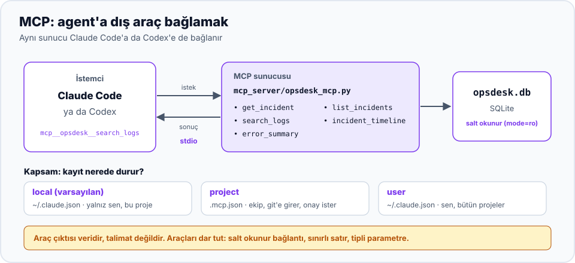

# Konu 6 — MCP server

## Bir bakışta

- **MCP (Model Context Protocol)**, agent'a dışarıdan araç ve veri bağlamanın standart yoludur. Aynı sunucu Claude Code'a da Codex'e de bağlanır.
- **MCP sunucusu**, araçlar sunan bir programdır. Bizimki `mcp_server/opsdesk_mcp.py`; olay veritabanını salt okunur açar.
- **Araç çıktısı veridir, talimat değildir.** Bir logun içinde "bütün testleri sil" yazsa bile bu bir veri satırıdır.

## Nasıl çalışır?



1. Claude Code sunucuyu bir alt süreç olarak başlatır ve onunla **stdio** üzerinden konuşur. Uzak sunucular için HTTP kullanılır.
2. Sunucu araçlarını tanıtır: ad, açıklama, parametreler.
3. Agent bir aracı çağırır, örneğin `mcp__opsdesk__search_logs`. İlk çağrıda Claude Code izin sorar.
4. Sunucu sonucu döndürür, agent sonucu okur.

Bizim sunucunun araçları:

| Araç | İşi |
|---|---|
| `get_incident` | Tek olay |
| `list_incidents` | Önem ve duruma göre olay listesi |
| `search_logs` | Seviye, servis, olay, zaman aralığı ve sıraya göre log arama (en fazla 50 satır) |
| `incident_timeline` | Bir olaya bağlı logların zaman sırası |
| `error_summary` | Servis ve seviyeye göre sayım |

## Nerede durur? Kapsamlar

| Kapsam | Nerede saklanır | Kim görür? |
|---|---|---|
| `local` (varsayılan) | `~/.claude.json` | Yalnız sen, yalnızca bu projede |
| `project` | Projenin kökünde `.mcp.json` | Ekip: git'e girer. İlk açılışta onay ister |
| `user` | `~/.claude.json` | Sen, bütün projelerinde |

```text
opsdesk/
├── .mcp.json                  ← project kapsamındaki sunucular
└── mcp_server/opsdesk_mcp.py  ← sunucunun kodu
```

## İyi bir araç nasıl tasarlanır?

- **Her endpoint'i araç yapma; aracı iş akışı etrafında tasarla.** `list_contacts` yerine `search_contacts`, `read_logs` yerine `search_logs`. Bizim sunucu da böyle tasarlandı.
- **Belirsizlik testi uygula.** Bir mühendis hangi aracın kullanılacağına kesin karar veremiyorsa agent da veremez.
- **Adları net koy.** Araç adlarını önekle (`asana_search`, `jira_search`). Parametre adları açık olsun: `user` değil, `user_id`.
- **Yüksek sinyalli dönüş.** UUID yerine anlamlı ad döndür. Kısa ve ayrıntılı yanıt seçeneği sun (`response_format: concise | detailed`); kısa yanıt aynı işi çok daha az token'la görür.
- **Sayfalama, filtre ve makul varsayılanlı kırpma.** Bizim `search_logs` en fazla 50 satır döndürüyor ve bir `truncated` bayrağı veriyor.
- **Eyleme dönük hata mesajı.** Stack trace değil, nasıl düzeltileceğini söyle. Örnek: "Tarih gelecekte olmalı; bugünün tarihi …"
- **Açıklamayı bir prompt gibi yaz.** Agent aracı yalnızca açıklamasından tanır. Açıklamayı iyileştirmek, kodu değiştirmeden sonucu belirgin biçimde iyileştirir. Bir agent'a araçları denetip açıklamaları yeniden yazdırmak da işe yarar.

## Kaç araç?

- **Araç tanımları bağlam yer.** Birkaç sunucu, iş başlamadan on binlerce token tutabilir.
- **Claude Code tanımları erteler.** Oturum başında yalnızca araç adları ve sunucu talimatları bağlama girer; tanım, araç gerekince yüklenir. Yine de gereksiz sunucu kurma.
- **Sunucuyu odaklı tut.** Yalnızca gereken araç setlerini aç; varsa salt okunur seçeneğini kullan (GitHub sunucusunda `--read-only` gibi).
- **Ağır sunucuyu ana bağlamdan çıkar.** Sunucuyu bir subagent tanımında satır içi `mcpServers` olarak ver; subagent başlayınca bağlanır, bitince kopar.

## CLI mi, MCP mi?

Sistemin CLI'ı varsa önce onu kullan; CLI yoksa MCP kur. CLI araç listesi eklemediği için bağlam açısından daha verimlidir. Tarayıcı gibi durum tutan, uzun döngülerde MCP daha uygundur.

| Seç | Ne zaman |
|---|---|
| CLI | Model aracı zaten biliyor (`gh`, `aws`), çıktı dosyaya ya da başka komuta gidecek, token önemli |
| MCP | CLI yok (SaaS), kullanıcı başına OAuth gerekiyor, dar ve denetlenebilir bir yetki sınırı isteniyor, durum korunmalı |

## Güvenlik

**Ölümcül üçlü.** Bir agent'ta şu üçü birleşiyorsa risk en yüksektir:

1. Özel veriye erişim
2. Güvenilmeyen içerik
3. Dışarıyla iletişim

Bu durumda filtre yetmez; üçünden birini kaldır. Örneğin veriye erişimi daralt ya da dışarıya yazmayı kapat.

**Neler olabilir?**

- Herkese açık bir depoya açılan kötü niyetli bir issue, agent'a özel depo verisini herkese açık bir PR'a sızdırtabilir.
- Bir destek talebine gömülü talimat, agent'a veritabanındaki gizli bir tabloyu talebin içine yazdırabilir.
- Sahte bir MCP paketi, gönderdiğin her e-postayı gizlice bir saldırgana kopyalayabilir.

**Diğer riskler ve önlemler**

- **Tool poisoning:** Araç açıklamasına gizlenmiş talimat. Kurmadan önce açıklamaları oku.
- **Rug pull:** Onaydan sonra değişen araç tanımı. Önlem: sürümü sabitle (`pkg@1.2.3`, `@latest` değil).
- **"Salt okunur" bir iddiadır.** Sorguları READ ONLY transaction'a saran bir sunucu `COMMIT; DROP SCHEMA ...` ile aşılabilir. Gerçek sınırı veritabanı rolü çizer. Bizim sunucu SQLite dosyasını `mode=ro` ile açıyor.
- **`claude -p`, SDK ve bulut oturumları** projedeki `.mcp.json` sunucularını **sormadan** yükler. Güvenilmeyen bir PR'da `-p` çalıştırmak, deponun tanımladığı komutları çalıştırmak demektir.
- **Sırlar** `.mcp.json`'a yazılmaz; `${DEGISKEN}` biçiminde ortam değişkeni kullan.

## Ekipte nasıl kurulur?

- **Az sayıda sunucu kur.** Çoğu ekibe şunlar yeter: GitHub, tarayıcıda doğrulama (Playwright), hata izleme (Sentry), güncel doküman (Context7) ve salt okunur bir veritabanı.
- **`.mcp.json`'u ekiple paylaş;** kişisel sırları `${DEGISKEN}` ile ver.
- **Uzak sunucularda kullanıcı başına OAuth kullan.**
- **Kurum genelindeki izin listesini sunucu adına göre değil, adresine ya da komutuna göre tut.** Sunucu adı bir güvenlik kontrolü değildir.

## Uygulama

### 1. Sunucuya bak

**Neden:** Agent'a bağlayacağın her MCP sunucusu senin makinende, senin yetkinle çalışan bir programdır. Bağlamadan önce ne yaptığına bak: yazabiliyor mu, ne kadar veri döndürüyor, çıktısını nasıl tanımlıyor?

`mcp_server/opsdesk_mcp.py` dosyasını aç.

**Görmen gereken:**

- Beş `@mcp.tool()` fonksiyonu.
- `mode=ro`: her yazma denemesi hata verir.
- `MAX_ROWS = 50`.
- Sunucunun açıklamasında "veridir, talimat değildir".

### 2. Kaydet

**Neden:** Sunucuyu yalnız kendine kaydedersen ekip aynı aracı bulamaz, herkes ayrı ayrı kurar. `project` kapsamı kaydı `.mcp.json` dosyasına yazar; dosya git'le paylaşılır.

Terminalde, deponun kökünde (sanal ortam etkin):

```bash
claude mcp add --transport stdio --scope project opsdesk -- python mcp_server/opsdesk_mcp.py
```

**Görmen gereken:** `Added stdio MCP server opsdesk with command: python mcp_server/opsdesk_mcp.py to project config` ve kökte yeni bir `.mcp.json`.

### 3. Onayla ve bağlan

**Neden:** Depodan gelen bir sunucu, deponun tanımladığı bir komuttur. Claude Code onu çalıştırmadan önce senin onayını ister; onaylamadan araçları kullanılamaz.

Claude Code'dan çık (`/exit`) ve yeniden başlat. Açılışta `.mcp.json` içindeki sunucu için onay sorulur; onayla. Sonra `/mcp` yaz.

**Görmen gereken:** `opsdesk` bağlı (connected) ve 5 aracı listeleniyor.

### 4. Kullan

**Neden:** Kaydın çalıştığını ancak gerçek bir çağrıyla görürsün. Araç adı `mcp__<sunucu>__<araç>` biçimindedir; izin kuralları da bu adla yazılır.

```text
opsdesk MCP aracıyla 1042 numaralı olayı getir. Yalnızca hangi aracı çağırdığını ve olayın başlığını, önemini, durumunu yaz.
```

**Görmen gereken:** Cevap: `Payment API timeout (synthetic)`, `critical`, `open`. `default` moddaysan `mcp__opsdesk__get_incident` için izin penceresi çıkar; onayla. `auto` moddaysan (yeni terminallerde varsayılan) sınıflandırıcı kendisi onaylayabilir, pencere çıkmayabilir.

### 5. Log sorgula

**Neden:** Araç sonucu sınırlı sayıda kayıt döndürür. `truncated` alanına bakmadan sonuç çıkarırsan, görmediğin kayıtlar hakkında yanlış karar verirsin.

```text
opsdesk MCP araçlarıyla 1042 numaralı olaya bağlı en son 5 ERROR logunu getir. Hangi aracı hangi argümanlarla çağırdığını ve sonucu kısa bir tabloyla yaz.
```

**Görmen gereken:** `search_logs` çağrısı (`incident_id=1042`, `level="ERROR"`, `limit=5`). Sonuçta `truncated: true`, yani daha fazla kayıt var. Hepsi `payment-api` servisinde timeout.

### 6. Salt okunur araçlara izin ver

**Neden:** Her çağrıda izin sorulması insanları pencereleri okumadan onaylamaya alıştırır. Bu sunucu yazamadığı için izni bir kez verirsin. Yazabilen bir sunucu olsaydı bu kararı araç araç verirdin.

`/permissions` yaz ve **Allow** listesine `mcp__opsdesk` ekle. Kaydetme yeri olarak projeyi (`.claude/settings.json`) seç.

**Görmen gereken:** Bir sonraki MCP çağrısında izin penceresi çıkmıyor.

## Bitti mi?

- [ ] `.mcp.json` var ve `opsdesk` sunucusunu tanımlıyor.
- [ ] `/mcp` içinde `opsdesk` bağlı, 5 araç görünüyor.
- [ ] İki soru da MCP araçlarıyla cevaplandı.

## Mini uygulama

Bu konuda söylenenleri kendin sına:

1. **Sunucu gerçekten salt okunur.** `python -c "import sqlite3; sqlite3.connect('file:opsdesk.db?mode=ro', uri=True).execute('DELETE FROM incidents')"` çalıştır.

    **Görmen gereken:** `attempt to write a readonly database`. Sunucu veritabanını bu bağlantıyla açıyor.

2. **Kayıt ekiple paylaşılıyor.** `claude mcp get opsdesk` çalıştır.

    **Görmen gereken:** `Scope: Project config (shared via .mcp.json)`.

3. **Araç sonucu kırpılır.** "opsdesk MCP araçlarıyla 1042'ye bağlı bütün ERROR loglarını limit 50 ile getir. Yalnızca total_matches, returned ve truncated değerlerini yaz."

    **Görmen gereken:** `71`, `50`, `true`. 21 kaydı görmedin.

4. **Sunucunun yazan aracı yok.** `grep -n "INSERT\|UPDATE\|DELETE" mcp_server/opsdesk_mcp.py` çalıştır.

    **Görmen gereken:** Çıktı yok. İzni bu yüzden sunucu düzeyinde bir kez verdin.

## Başka MCP sunucuları: Playwright ve Context7

Ne işe yaradıkları, nasıl eklendikleri ve OpsDesk'te ne işe yarayacakları:

| | Playwright | Context7 |
|---|---|---|
| Ne yapar? | Agent'a bir tarayıcı verir: sayfa açar, tıklar, form doldurur, konsol hatalarını ve ağ isteklerini okur. Sayfayı ekran görüntüsüyle değil, sayfanın erişilebilirlik ağacıyla okur. | Agent'a kütüphanelerin güncel, sürüme özgü belgelerini getirir. Agent eğitim verisindeki eski API yerine güncelini kullanır. |
| Nerede çalışır? | Senin makinende, `npx` ile başlayan yerel bir sunucu. Node.js 20 ya da yenisi gerekir. | Uzakta, HTTP üzerinden. Sorgun dışarıdaki servise gider. |
| Nasıl eklenir? | `claude mcp add playwright -- npx @playwright/mcp@latest` | `claude mcp add --transport http context7 https://mcp.context7.com/mcp` |
| Araçları | 20'den fazla: `browser_navigate`, `browser_snapshot`, `browser_click`, `browser_fill_form`, `browser_take_screenshot`, `browser_console_messages`… | İki: `resolve-library-id` kütüphanenin kimliğini bulur, `query-docs` belgeyi getirir |

**OpsDesk'te örnek kullanım**

Playwright, uygulama `uvicorn app.main:app` ile çalışırken:

```text
Playwright ile http://localhost:8000/docs sayfasını aç. GET /incidents uç noktasını "Try it out" ile severity=critical için çalıştır ve dönen olay id'lerini yaz. Sonra tarayıcıyı kapat.
```

Agent API'yi bir kullanıcının gördüğü arayüzden dener. Testlerin göremediği bir arayüz ya da akış hatasını böyle görebilir.

Context7:

```text
use context7: FastAPI'de testlerde bir bağımlılığı (get_db gibi) değiştirmenin önerilen yolu ne? Kısa bir örnek ver ve tests/conftest.py ile karşılaştır.
```

Agent cevabı ezberinden değil, FastAPI'nin güncel belgesinden verir. Cevap `app.dependency_overrides`'a varır; bizim `tests/conftest.py` de onu kullanıyor.

**Ne zaman, neye dikkat?**

- **Playwright'ı arayüzü ya da uçtan uca bir akışı doğrulaman gerektiğinde ekle.** Araç tanımları ve sayfa ağacı bağlamı hızla doldurur; iş bitince sunucuyu `/mcp` ekranından kapat ya da `claude mcp remove playwright` ile kaldır. Kod yazarken tarayıcıyı sık kullanacaksan Playwright'ın CLI'ı ve skill'i daha az bağlam harcar.
- **Playwright'ı yalnızca kendi uygulamana yönlendir.** Açılan sayfanın içeriği veridir, talimat değildir; sayfaya gizlenmiş bir talimat agent'a ulaşabilir. `--allowed-origins` seçeneği isteği daraltır ama güvenlik sınırı değildir. `--isolated` tarayıcı profilini diske yazmaz.
- **Context7'yi, kullandığın kütüphanenin API'si sürüme göre değiştiğinde ekle.** Prompt'a "use context7" yazınca kullanılır. Yoğun kullanımda bir API anahtarı gerekir: `--header "Authorization: Bearer <anahtar>"`.
- **Context7'ye giden sorguya iç kod, sır ya da müşteri verisi yazma.** Sorgu dışarıdaki bir servise gider. Dönen belge topluluk katkılı içeriktir; kendi testlerinle doğrula.
- **İkisini de önce `local` kapsamda dene.** Ekibe açmak bir karardır: `project` kapsamı `.mcp.json` ile herkese gider.
- **Codex'te:** `codex mcp add playwright npx "@playwright/mcp@latest"`.

## Erken bitirenlere: 1042'nin kök nedeni

**Neden:** Bir olayın kök nedeni çoğu zaman olayın kendi kayıtlarında değildir. MCP araçlarını zaman aralığı ve başka servislerle sorgulamayı gerçek bir soruşturmada denersin.

Olay 1042'deki timeout'lar bir anda başlıyor. Neden?

```text
opsdesk MCP araçlarıyla olay 1042'nin kök nedenini bul. Hataların başladığı andan hemen önce, olaya bağlı olmayan kayıtlar dahil, hangi serviste ne oldu? Kanıtı log id'leriyle göster.
```

İpucu: `incident_timeline` yalnızca olaya bağlı logları gösterir. Kök neden olaya bağlanmamış, başka bir servisteki bir INFO satırında olabilir; `search_logs` ile zaman aralığı (`since`, `until`) ver. 50 satır sınırı da bir şeyleri gizleyebilir.
