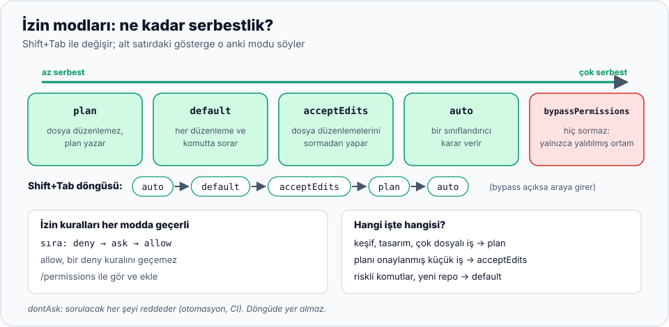

# Konu 7 — Plan mode ve izin modları

## Bir bakışta

- **İzin modu**, agent'ın neyi sormadan yapabileceğini belirler. `Shift+Tab` ile değişir; o anki mod altta görünür.
- **Plan modu** dosya düzenlemez, plan yazar; düzenleme plan onaylanınca başlar. Bir planı düzeltmek, kodu düzeltmekten ucuzdur.
- **İzin kuralları** (`allow`, `ask`, `deny`) her modda geçerlidir ve önce `deny` değerlendirilir. Bir `allow` kuralı bir `deny` kuralını geçemez.

## Nasıl çalışır?



| Mod | Ne yapar | Ne zaman |
|---|---|---|
| `plan` | Dosya düzenlemez, plan yazar, onay ister | Keşif, tasarım, çok dosyalı iş |
| `default` (manuel) | Her düzenleme ve komutta sorar | Yeni bir repo, riskli komutlar |
| `acceptEdits` | Dosya düzenlemelerini sormadan yapar; diğer komutlarda sorar | Planı onaylanmış küçük bir iş |
| `auto` | Bir sınıflandırıcı neyin güvenli olduğuna karar verir | Rutin işler; sürüme ve hesaba göre varsayılan olabilir |
| `dontAsk` | Sorulacak her şeyi reddeder | Otomasyon, CI |
| `bypassPermissions` | Hiç sormaz | **Yalnızca** yalıtılmış ortam (container, sanal makine) |

> Güncel sürümlerde terminalde varsayılan başlangıç modu `auto` olabilir. Hangi modda olduğunu her zaman alt satırdan kontrol et.

**Plan onayı.** Plan modunda agent planı bitirince sana seçenek sunar: planı onaylayıp düzenlemelere geçmek (otomatik ya da her düzenlemeyi elle onaylayarak) ya da plan yapmaya devam etmek.

**İzin kuralı örnekleri:**

| Kural | Anlamı |
|---|---|
| `Bash(pytest *)` allow | `pytest` ile başlayan komutlar sormadan çalışır |
| `Read(./.env)` deny | `.env` hiçbir modda okunmaz |
| `mcp__opsdesk` allow | `opsdesk` sunucusunun bütün araçları sormadan çalışır |

## Uygulama: OPS-102

**OPS-102: Olayları duruma göre filtrele**

- `GET /incidents` opsiyonel `status` parametresi alır: `open`, `investigating`, `resolved`.
- `severity` ile birlikte verilirse iki koşul birden uygulanır.
- Geçersiz `status` değeri 422 döner.
- Parametre yoksa mevcut davranış korunur.

### 1. Modları gör

**Neden:** Agent'ın neyi sormadan yapacağını mod belirler. Hangi modda olduğunu bilmeden çalışırsan, sorulmadan yapılan bir düzenleme ya da gereksiz izin pencereleri seni şaşırtır.

`Shift+Tab`'a birkaç kez bas ve alttaki göstergeyi izle.

**Görmen gereken:** `plan` ve `accept edits` gibi modlar sırayla geliyor.

### 2. Plan modunda planlat

**Neden:** Plan modunda agent kodu okur ve plan yazar ama dosya düzenlemez. Yanlış anlaşılan bir isteği planda düzeltmek, yazılmış kodu düzeltmekten çok daha ucuzdur.

Plan moduna geç (`Shift+Tab` ya da `/plan`) ve yaz:

```text
OPS-102: GET /incidents opsiyonel status parametresi alsın (open, investigating, resolved). severity ile birlikte verilirse iki koşul birden uygulanır. Geçersiz status 422 döner. Parametre yoksa mevcut davranış korunur. Bunun için kısa bir uygulama planı çıkar: dokunulacak dosyalar, eklenecek testler, riskler.
```

**Görmen gereken:** Dosyaları okuyor ama düzenlemiyor. Planda `app/main.py`, yeni bir test dosyası ve riskler var.

### 3. Planı sorgula

**Neden:** Agent'ın planı çoğunlukla makuldür ama her riski görmez. Örneğin ortak örnek veriye kayıt eklemek mevcut testleri kırar. Bunu planda sorarak yakalarsın; kodda yakalarsan geri dönüp düzeltmen gerekir.

Planı oku ve en az bir soru sor. Örnekler:

- "Mevcut testlere ya da `tests/conftest.py`'ye dokunuyor musun? Dokunuyorsan neden?"
- "`investigating` durumunda örnek kayıt yok. Testte bunu nasıl kuracaksın?"

**Görmen gereken:** Agent planı güncelliyor. Kaydı test içinde oluşturuyor; ortak örnek veriye dokunmuyor.

### 4. Onayla

**Neden:** Onaylarken agent'a ne kadar serbestlik vereceğini seçersin. Her düzenlemeyi elle onaylamak ile `accept edits` arasındaki farkı aynı işte görmek, hangi işte hangisini seçeceğine karar vermeni kolaylaştırır.

Onay seçeneklerini oku. Önce **her düzenlemeyi elle onaylayacağın** seçeneği seç. İki düzenlemeyi onayladıktan sonra `Shift+Tab` ile `accept edits` moduna geç.

**Görmen gereken:** `accept edits`'e geçince düzenlemeler sorulmadan yapılıyor, ama `pytest` gibi komutlar hâlâ soruluyor.

### 5. Testleri sorulmadan çalıştır

**Neden:** Her test çalıştırmasında izin sorulursa ya akış durur ya da pencereler okunmadan onaylanmaya başlar. Güvenli ve sık kullanılan bir komutu `allow` kuralıyla önceden onaylarsın.

`/permissions` yaz ve **Allow** listesine `Bash(pytest *)` ekle. Sonra agent'tan testleri çalıştırmasını iste.

**Görmen gereken:** `pytest` artık sormadan çalışıyor ve bütün testler geçiyor (12 eski + yeni testler).

## Bitti mi?

- [ ] Plan modunda hiçbir dosya değişmeden bir plan çıktı.
- [ ] Planda en az bir şeyi düzelttirdin.
- [ ] Elle onay ile `accept edits` arasındaki farkı gördün.
- [ ] `pytest -q` geçiyor.

## Mini uygulama

Bu konuda söylenenleri kendin sına:

1. **Plan modu dosya düzenlemez.** Plan modunda iste: "README.md'nin sonuna 'deneme' satırını ekle." Planı onaylama, `Esc` ile çık ve `git diff --stat README.md` çalıştır.

    **Görmen gereken:** Agent plan yazdı; `README.md` değişmedi.

2. **`accept edits` sormadan düzenler.** `accept edits` modunda aynı isteği yap.

    **Görmen gereken:** Düzenleme sorulmadan yapılıyor; `git diff --stat README.md` bir satır gösteriyor. Geri al: `git checkout -- README.md`.

3. **İzin kuralı komutu birebir eşler.** `default` ya da `accept edits` modundayken: "python -m pytest -q komutunu çalıştır."

    **Görmen gereken:** İzin soruluyor. `Bash(pytest *)` yalnızca `pytest` ile başlayan komutu eşler.

4. **`deny` her modda geçerli.** `accept edits` modundayken: "Bu bir izin ayarı denemesi. Read aracıyla ./.env dosyasını okumayı dene ve dönen mesajı aynen yaz."

    **Görmen gereken:** `File is in a directory that is denied by your permission settings.`
