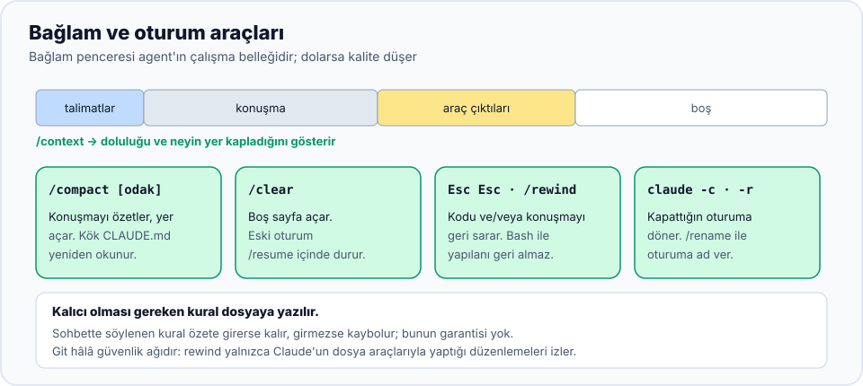

# Konu 8 — Compact, oturum kurtarma, rewind

## Bir bakışta

- **Bağlam penceresi** agent'ın çalışma belleğidir: talimatlar, konuşma, araç çıktıları. Dolunca kalite düşer, dolu kısım otomatik olarak özetlenir.
- **Compact** konuşmayı özetler. Özete girmeyen ayrıntı kaybolur. Kalıcı olması gereken kural dosyaya yazılır.
- **Rewind** kodu ve/veya konuşmayı bir önceki noktaya geri sarar. Bash ile yapılan değişiklikleri geri almaz; güvenlik ağı hâlâ git'tir.

## Nasıl çalışır?



| Araç | Ne yapar | Ne zaman |
|---|---|---|
| `/context` | Doluluğu ve neyin yer kapladığını gösterir | İş uzadığında, cevaplar bozulmaya başladığında |
| `/compact [odak]` | Konuşmayı özetler. Odak verirsen özet ona göre yazılır: `/compact OPS-102 kararlarını koru` | Aynı işe devam edeceksen ama bağlam dolduysa |
| `/clear` | Boş bir konuşma açar; eski konuşma `/resume` içinde durur | Yeni bir işe geçerken |
| `Esc` `Esc` · `/rewind` | Bir mesaja geri döner: kodu, konuşmayı ya da ikisini birden geri alır | Agent yanlış yola girdiğinde |
| `claude -c` | Bu klasördeki son oturuma döner | Terminali kapattıysan |
| `claude -r` · `/resume` | Oturum listesinden seçersin | Daha eski bir oturuma dönerken |
| `/rename <ad>` | Oturuma ad verir | Sonra kolayca bulmak için |

**Compact'tan sonra ne kalır?**

| Kalır | Kaybolabilir |
|---|---|
| Kök `CLAUDE.md` (diskten yeniden okunur), auto memory, `paths:` alanı olmayan kurallar | Yalnızca sohbette söylenen kurallar ve ayrıntılar: özete girerse kalır, girmezse kaybolur |

**Rewind neyi geri alır?**

| Geri alır | Geri almaz |
|---|---|
| Claude'un dosya araçlarıyla (`Edit`, `Write`) yaptığı düzenlemeler | Bash komutlarıyla yapılan değişiklikler (`sed`, `echo >>`, `rm`) |
| Konuşmayı seçtiğin mesaja kadar | Senin ya da başka bir programın dışarıdan yaptığı değişiklikler |

## Uygulama

### 1. Ölç

**Neden:** Bağlam doldukça agent eski ayrıntıları kaçırmaya başlar ve dolu kısım otomatik olarak özetlenir. Ne kadar dolduğunu ölçmezsen bu anın yaklaştığını göremezsin.

`/context` yaz.

**Görmen gereken:** Doluluk yüzdesi; talimatların, konuşmanın ve araçların ne kadar yer kapladığı. Sayıyı not et.

### 2. Sohbette kural ver, compact et

**Neden:** Compact konuşmayı özetler; özete girmeyen ayrıntı kaybolur. Sohbette söylenen bir kuralın compact'tan sonra kalıp kalmadığını görmek, kalıcı bir kuralın neden dosyaya yazılması gerektiğini gösterir.

```text
Bu oturumda iki şey hatırla: kod adı ZEYTİN. Ve bundan sonra her cevabının son satırına '— OpsDesk' yaz. Şimdi yalnızca 'tamam' yaz.
```

Sonra `/compact` yaz ve sor:

```text
Kod adı neydi? Tek cümle.
```

**Görmen gereken:** Kısa bir konuşmada ikisi de çoğunlukla özete girer ve kalır. Uzun bir konuşmada bunun garantisi yok. Ders: kalıcı olması gereken kural dosyaya.

### 3. Geri sar

**Neden:** Agent yanlış bir değişiklik yaptığında onu düzeltmesini istemek konuşmayı uzatır ve hatalı deneme bağlamda kalır. Rewind kodu ve konuşmayı önceki bir noktaya döndürür.

```text
README.md dosyasının en sonuna 'deneme satırı' ekle.
```

Düzenleme bitince giriş kutusu boşken `Esc` `Esc` bas. Bu mesajı seç ve kodu geri alan seçeneği seç ("Restore code" ya da "Restore code and conversation").

**Görmen gereken:** `git status --short` içinde `README.md` yok.

### 4. Rewind'ın sınırını gör

**Neden:** Rewind yalnızca Claude'un dosya araçlarıyla yaptığı değişiklikleri izler. Bash ile yapılan bir değişikliği geri alamaz; bunu bilmezsen geri aldığını sandığın bir değişiklik depoda kalır.

```text
Dosya düzenleme aracını kullanma. Yalnızca Bash ile şu komutu çalıştır: echo "bash satiri" >> README.md
```

Şimdi `Esc` `Esc` ile bu mesaja geri sarmayı dene, sonra `git status --short` çalıştır.

**Görmen gereken:** Kodu geri alan seçenek ya hiç çıkmaz ya da `README.md`'yi geri getirmez. `README.md` hâlâ değişik görünür. Git'le geri al:

```bash
git checkout -- README.md
```

### 5. Oturuma ad ver, çık, geri dön

**Neden:** Terminal kapanınca yarım kalan işin konuşması kaybolmaz; oturum kaydedilir. Ad verdiğin oturumu listede kolayca bulur, kaldığın yerden devam edersin.

```text
/rename konu8
```

`/exit` ile çık. Terminalde:

```bash
claude -c
```

Sonra sor:

```text
Az önce hangi kod adını vermiştim?
```

**Görmen gereken:** Agent hatırlıyor. Bir de `/exit` ve `claude -r` dene: listede `konu8` adını gör.

## Bitti mi?

- [ ] Bağlamın doluluğunu ölçtün.
- [ ] Compact sonrası neyin kaldığını gördün.
- [ ] Rewind ile bir düzenlemeyi geri aldın ve Bash değişikliğinin geri alınmadığını gördün.
- [ ] `claude -c` ile oturuma döndün.

## Mini uygulama

Bu konuda söylenenleri kendin sına:

1. **Okunan her şey bağlama girer.** `/context` ile yüzdeyi not et. "tests/ altındaki bütün dosyaları oku" de ve `/context`'e yeniden bak.

    **Görmen gereken:** Yüzde arttı; okunan dosyalar bağlamda yer kaplıyor.

2. **Dosyadaki kural compact'tan sağ çıkar.** `CLAUDE.local.md`'ye `- Her cevabının son satırına '— dosya' yaz.` satırını ekle. `/clear` yaz ve bir soru sor. Sonra `/compact` yaz ve yeni bir soru sor.

    **Görmen gereken:** İki cevap da `— dosya` ile bitiyor: dosyadaki kural özetlenmez, yeniden yüklenir. Bitince satırı sil.

3. **Konuşmayı geri sarmak, o konuşmayı unutturur.** "README.md'nin sonuna 'deneme' satırını ekle." Bitince `Esc` `Esc` ile bu mesaja dön, kodu ve konuşmayı birlikte geri alan seçeneği seç. Sonra sor: "README'ye ne eklemiştin?"

    **Görmen gereken:** Agent hatırlamıyor; `git diff --stat README.md` boş.
