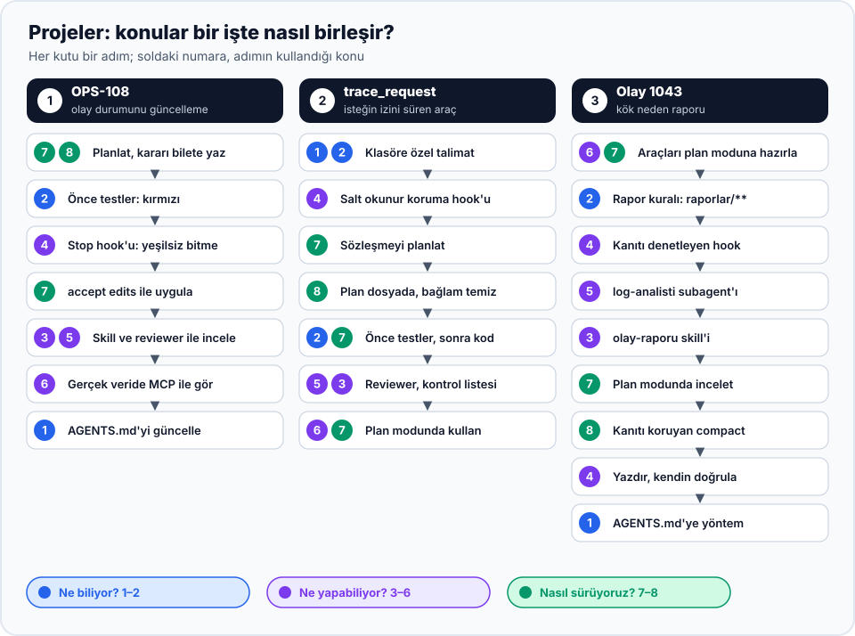

# Projeler



Bu projelerde bugünkü sekiz konuyu gerçek bir işte bir arada kullanırsın: bir API özelliği, bir MCP aracı ve bir olay incelemesi. Her proje tek başına yapılabilir.

| # | Proje | İş | Klasör |
|---|---|---|---|
| 1 | OPS-108: olay durumunu güncelleme | API'ye kuralları ve kaydıyla yeni bir endpoint | [1-durum-guncelleme/](1-durum-guncelleme/README.md) |
| 2 | `trace_request`: isteğin izini süren MCP aracı | MCP sunucusuna salt okunur yeni bir araç | [2-iz-araci/](2-iz-araci/README.md) |
| 3 | Olay 1043: kök neden raporu | Kanıta dayalı bir olay incelemesi ve onu denetleyen düzen | [3-olay-raporu/](3-olay-raporu/README.md) |

## Başlamadan

1–8. konularda kurduğun düzen deponda olmalı:

| Ne | Nerede | Konu |
|---|---|---|
| Ortak talimat ve onu içe aktaran `CLAUDE.md` | `AGENTS.md`, `CLAUDE.md` | 1 |
| Test kuralı | `.claude/rules/testler.md` | 2 |
| İnceleme skill'i | `.claude/skills/opsdesk-review/` | 3 |
| Testleri koruyan hook | `.claude/hooks/protect_tests.py` ve `settings.json` | 4 |
| İnceleme subagent'ı | `.claude/agents/reviewer.md` | 5 |
| MCP sunucusunun kaydı | `.mcp.json` | 6 |
| İzin kuralları | `settings.json` içinde `Bash(pytest *)` ve `mcp__opsdesk` | 6, 7 |

Eksik olan varsa o konunun `sablon/` klasöründen ya da uygulama adımlarından kur. Sonra:

```bash
pytest -q
```

**Görmen gereken:** Testler yeşil.

## Nasıl çalışılır?

- **Projeler aynı depoda.** Sırayla yaparsan kurduğun hook'lar, kurallar ve skill'ler birikir.
- **Adımlar hedefi söyler, prompt'u sen yazarsın.** Her adımda agent'tan ne istediğini ve neyi kanıt sayacağını sen belirlersin.
- **Kanıt olmadan "bitti" yok.** Her kabul kriteri için bir test, bir komut çıktısı ya da bir log kaydı göster.
- **Mevcut testler değişmez.** Bitirmeden önce `git diff tests/test_api.py tests/test_ops101.py tests/conftest.py` boş olmalı.

## Codex kullanıyorsan

Projeleri Codex'le de yapabilirsin:

| Claude Code | Codex |
|---|---|
| `.claude/skills/` | `.agents/skills/`; çağırmak için `$ad` |
| `settings.json` içindeki hook'lar | `.codex/hooks.json`; yeni hook'a `/hooks` içinde güvenmen gerekir |
| `.mcp.json` | `codex mcp add`; kayıt genel ayar dosyasına yazılır |
| Plan modu | `/plan` |
| `.claude/agents/` | `.codex/agents/<ad>.toml` |
