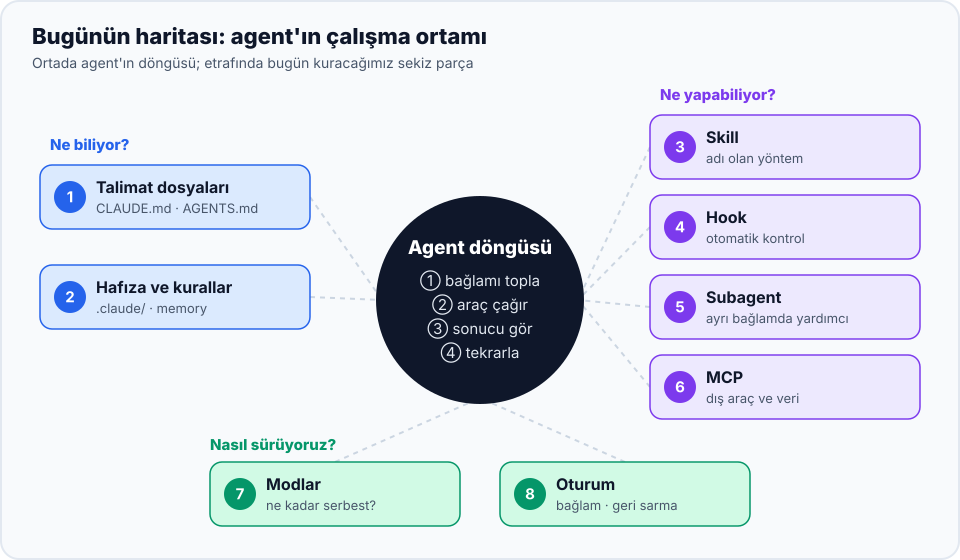

# 2. Gün — Agent'ın çalışma ortamını kurmak



Dün şunu gördük: agent'ın "bitti" demesi ve yeşil testler tek başına kanıt değil. Bugün agent'ın çevresini kuruyoruz. Üç soruyu yanıtlayacağız: agent ne biliyor, ne yapabiliyor, onu nasıl sürüyoruz?

## Uygulama adımları

Her konunun **Uygulama** bölümü kısa, numaralı adımlardan oluşur. Her adım, neden yapıldığını söyleyen bir **Neden** satırıyla başlar ve **Görmen gereken** satırıyla biter. Her konunun sonunda bir **Mini uygulama** var: o konuda söylenenleri kendin sınarsın.

Bir adımda "Görmen gereken" çıktıyı görmediysen sonraki adıma geçme. Sohbete yaz ya da elini kaldır.

## Konular

| # | Konu | Klasör | Bu konuda kuracağın |
|---|---|---|---|
| 1 | CLAUDE.md ve AGENTS.md | [1-claude-md-ve-agents-md/](1-claude-md-ve-agents-md/README.md) | Güncel `AGENTS.md` ve onu içe aktaran `CLAUDE.md` |
| 2 | `.claude` klasörü ve memory | [2-claude-klasoru-ve-memory/](2-claude-klasoru-ve-memory/README.md) | Test kuralı, kişisel tercih, `.env` için izin kuralı |
| 3 | Skill | [3-skill/](3-skill/README.md) | `opsdesk-review` skill'i |
| 4 | Hook | [4-hook/](4-hook/README.md) | Kabul testlerini koruyan hook |
| 5 | Subagent ve çoklu agent | [5-subagent/](5-subagent/README.md) | `reviewer` subagent'ı |
| 6 | MCP server | [6-mcp/](6-mcp/README.md) | `opsdesk` MCP sunucusunun kaydı |
| 7 | Plan mode ve izin modları | [7-plan-ve-izin-modlari/](7-plan-ve-izin-modlari/README.md) | Plan modunda OPS-102 |
| 8 | Compact, oturum kurtarma, rewind | [8-oturum/](8-oturum/README.md) | Kalıcı bir şey yok; denemeler |

Konular birbirinin üzerine kurulur. Sırayla git.

## Projeler

Sekiz konudan sonra, hepsini gerçek bir işte bir arada kullandığın üç proje var: bir API özelliği, bir MCP aracı ve bir olay incelemesi. [9-projeler/](9-projeler/README.md)

## Başlangıç

Dünkü dalında commit edilmemiş bir değişiklik varsa önce onu commit et. Sonra:

```bash
git switch main
git pull
git switch -c participant/<kimlik>/day2
python -m pip install -e '.[dev]' "mcp[cli]"
python -m scripts.seed_demo
python -m scripts.seed_logs
pytest -q
```

**Görmen gereken:**

- `pytest -q` çıktısı `12 passed`. OPS-101 bugün çözülmüş hâliyle geliyor.
- `seed_logs` çıktısı `Log seed tamamlandi: 151 kayit eklendi.` ya da `Log veri seti zaten var; kayit eklenmedi.` İkisi de doğru.

> **Claude Code'u bu klasörde, sanal ortam (venv) etkinken başlat.** Hook ve MCP sunucusu `python` komutunu oradan bulur.

## Codex kullanıyorsan

Adımlar Claude Code için yazıldı. Codex'te karşılıkları:

| Claude Code | Codex |
|---|---|
| `CLAUDE.md` | `AGENTS.md` |
| `.claude/skills/` | `.agents/skills/`; çağırmak için `$ad` |
| `settings.json` içindeki hook'lar | `.codex/hooks.json`; yeni hook'a `/hooks` içinde güvenmen gerekir |
| `.claude/agents/<ad>.md` | `.codex/agents/<ad>.toml` |
| `claude mcp add` | `codex mcp add`; kayıt genel ayar dosyasına yazılır |
| Plan modu, `/permissions` | `/plan`, `/permissions` |
| `/compact`, `claude -c` | `/compact`, `codex resume --last` |
| `Esc Esc` (kodu da geri alır) | `Esc Esc` (yalnızca konuşmayı geri alır) |

## Erken bitirenlere

- **Hook:** test çalıştıran ikinci bir hook kur. [4-hook/](4-hook/README.md) içinde, "Erken bitirenlere" bölümünde.
- **Subagent:** `test-runner` subagent'ını da ekle ve `/context` ile ana bağlamın ne kadar az dolduğuna bak. [5-subagent/](5-subagent/README.md) içinde.
- **MCP:** olay 1042'nin kök nedenini MCP araçlarıyla bul. [6-mcp/](6-mcp/README.md) içinde.
